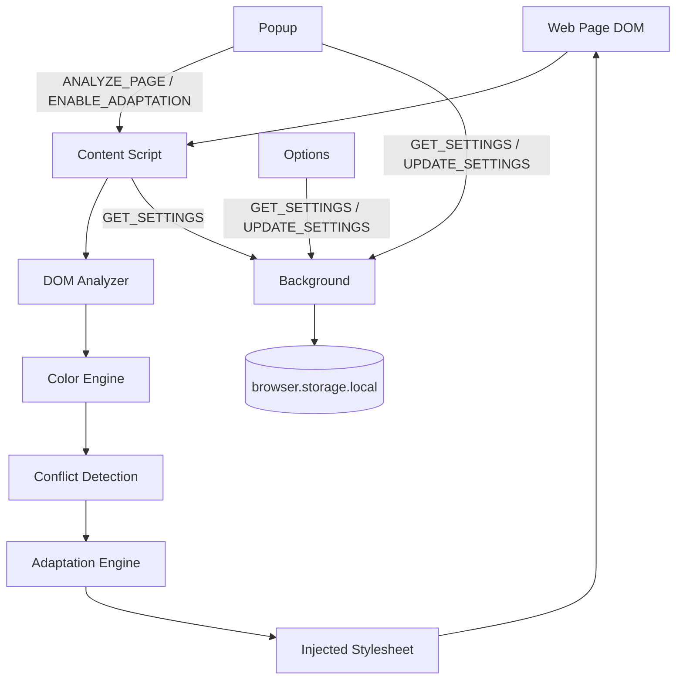

# Architecture

ColorAdapt is a WXT-based WebExtension (Manifest V3 on Chrome/Edge, MV2 on
Firefox, generated from one source tree). It has no backend: every module
below runs inside the browser, either in the background service worker, a
content script injected into the page, or an extension page (Popup/Options).

## Layering

```text
src/
  domain/          Pure types and constants. No dependencies on anything else.
  core/             Pure(ish) business logic: color math, DOM analysis,
                    conflict detection, adaptation decisions. Depends only
                    on domain/ and shared/. The DOM Analyzer and the
                    Adaptation Engine's StylesheetManager are the two places
                    core/ touches the real DOM — everything else is
                    deterministic and unit-testable without a browser.
  infrastructure/   WebExtension API access: storage, messaging, browser
                    utilities. This is the ONLY layer allowed to import
                    `wxt/browser`.
  features/         Glues core/ + infrastructure/ into something an
                    entrypoint can call: React hooks for the UI, and the
                    content-script controller that ties the DOM Analyzer /
                    Conflict Detector / Adaptation Engine together for one
                    document.
  entrypoints/      Thin WXT entrypoints (background, content script,
                    popup, options). Should contain almost no logic.
  shared/           Cross-cutting utilities/constants with no opinion about
                    domain, browser, or UI.
```

The rule that matters most: **core logic never imports React or
`wxt/browser`**, and **UI code never implements color math**. If a color
algorithm needs to change, only `core/color` changes.

## Modules

| Module                                    | Responsibility                                                                                                                                                                                                                                                                                                                                                                                                                                                                                                      |
| ----------------------------------------- | ------------------------------------------------------------------------------------------------------------------------------------------------------------------------------------------------------------------------------------------------------------------------------------------------------------------------------------------------------------------------------------------------------------------------------------------------------------------------------------------------------------------- |
| Color Engine (`core/color`)               | Parse/convert/compare colors; sRGB transfer functions; alpha-composite; OKLab distance; find accessible alternatives.                                                                                                                                                                                                                                                                                                                                                                                               |
| Vision Engine (`core/vision`)             | Replaceable, DOM-free color vision simulation (Brettel/Viénot/Machado + approximations); pair analysis. Holds no module-level mutable state or caches (M2.R1). See `docs/COLOR_VISION_SIMULATION.md`.                                                                                                                                                                                                                                                                                                               |
| DOM Analyzer (`core/analysis`)            | Bounded traversal of a document, resolving each element's effective foreground/background/role — see `docs/CSS_ANALYSIS.md`.                                                                                                                                                                                                                                                                                                                                                                                        |
| SVG layer (`core/svg`)                    | Isolated analysis of inline `<svg>` units: element roles, paint model, a style probe that tells `currentColor` / inherited / explicit paint apart, `<use>`/`<symbol>`, a bounded scan, verification. See `docs/SVG_ANALYSIS.md`.                                                                                                                                                                                                                                                                                    |
| Semantic core (`core/semantics`)          | DOM-free semantic accessibility: facts → evidence → `SemanticResult` (confidence, conflicts) → color-only verdict → `SemanticCuePlan`. Prefers `unknown` to a wrong state; color alone never classifies. See `docs/SEMANTIC_ACCESSIBILITY.md`.                                                                                                                                                                                                                                                                      |
| Semantic cues (`features/semantics`)      | The only code that reads semantic facts from the DOM and applies cues: one `data-coloradapt-cue` attribute per element plus static cue CSS inside the managed `<style>`, verified against the browser. No observer of its own (M4 drives it).                                                                                                                                                                                                                                                                       |
| Chart core (`core/charts`)                | DOM-free chart semantics (M7): facts -> classification (type, confidence, blockers) -> series -> legend mapping -> pairwise M2 analysis -> `ChartAdaptationPlan` (line style, marker, pattern per series). Prefers `limited`/`unsupported` to a guess. See `docs/CHARTS.md`.                                                                                                                                                                                                                                        |
| Chart layer (`features/charts`)           | The only code that reads an `<svg>` into chart facts and applies a plan: owned `<defs>`, decorative overlays, `data-coloradapt-chart-*` attributes and one static CSS portion inside the managed `<style>`; verifies against the browser, rolls back, reverses. No document observer (M4 delivers regions); a bounded `ResizeObserver` + scoped `MutationObserver` bridge (`chart-watch.ts`) only signals M4. The HTML legend guard (`html-legend.ts`) refuses charts that may have a legend M7 cannot synchronize. |
| Conflict Detection (`core/conflicts`)     | Decide whether a foreground/background pair is a likely problem for a vision profile.                                                                                                                                                                                                                                                                                                                                                                                                                               |
| Adaptation Engine (`core/adaptation`)     | Constrained candidate search (OKLCH) -> `AdaptationResult` -> DOM-free `AdaptationPlan`; the stylesheet manager applies/restores a plan. See `docs/ADAPTATION_ENGINE.md`.                                                                                                                                                                                                                                                                                                                                           |
| Settings Store (`infrastructure/storage`) | The only code that knows the storage schema/keys; validates data read back from `browser.storage`.                                                                                                                                                                                                                                                                                                                                                                                                                  |
| Messaging (`infrastructure/messaging`)    | Typed message contracts and a typed router, instead of ad-hoc strings.                                                                                                                                                                                                                                                                                                                                                                                                                                              |
| Page Analysis / Settings (`features/`)    | Content-script controller; React hooks (`useSettings`, `usePageAnalysis`) for Popup/Options.                                                                                                                                                                                                                                                                                                                                                                                                                        |

## Data flow — analysis & adaptation



## Messaging

See `src/infrastructure/messaging/messages.ts` for the full typed contract.
Two independent channels are used, matching what the WebExtension APIs
actually support:

- **Extension pages → Background** (`browser.runtime.sendMessage`): `GET_SETTINGS`,
  `UPDATE_SETTINGS`. Background is the single writer of settings.
- **Extension pages → Content Script of one tab** (`browser.tabs.sendMessage`):
  `ANALYZE_PAGE`, `GET_ANALYSIS`, `ENABLE_ADAPTATION`, `DISABLE_ADAPTATION`,
  `REFRESH_ADAPTATION`. Only a content script can see/modify the page DOM.
  Two debug-only messages, `GET_DYNAMIC_DIAGNOSTICS` and `FLUSH_DYNAMIC`, expose the
  dynamic pipeline's local counters to the E2E suite (nothing leaves the device).

Every message is validated at the receiving end with `isColorAdaptMessage`
before being dispatched, since both `runtime.onMessage` and
`tabs.onMessage` are untyped `any` channels shared with other code.

## Adaptation lifecycle

1. Content script loads, asks Background for current settings.
2. If enabled, it runs the DOM Analyzer (bounded by
   `docs/PERFORMANCE.md`'s budget) over the page. Each element's
   effective foreground/background is resolved through ancestor
   traversal and nested opacity-group compositing (opacity dims an element
   and its descendants as one group, not per layer; `opacity` on `html`/`body`
   yields `partial`) — see `docs/CSS_ANALYSIS.md`.
3. Elements whose background could not be confidently resolved (a
   gradient/image in the visible stack) are excluded from Conflict
   Detection entirely — see `ElementDescriptor.analysisStatus`. The rest
   go through Conflict Detection for the active vision profile.
4. Every `resolved` element goes through the Adaptation Engine
   (`createAdaptationPlan` -> `findAdaptation`): problem detection from the
   M2 simulated distance, a bounded OKLCH candidate search, scoring, and a
   foreground-only color that is the smallest sufficient change with no
   material WCAG contrast regression — or `no-safe-candidate`. `partial`/
   `unsupported` elements are never adapted. The result is a data-only
   `AdaptationPlan`; the core never writes CSS. See
   `docs/ADAPTATION_ENGINE.md`.
5. Changes are applied as CSS rules in a single injected
   `<style id="coloradapt-stylesheet">`, targeting elements via a
   `data-coloradapt-id` attribute — never inline styles, never direct DOM
   mutation of content. Elements whose `color` is animated are not adapted. Every
   commit suppresses `transition` for one synchronous style flush (no fade or
   flicker), and the browser's computed color is read back: a change the cascade
   did not honor (e.g. inline `!important`) is dropped and counted as
   `notApplied` (`docs/ADAPTATION_ENGINE.md`, "CSS application policy").
6. After the first adaptation, a dynamic-site pipeline (M4,
   `features/dynamic-analysis`) keeps it current: one `MutationObserver` ->
   own-mutation filter -> per-frame batcher -> classifier -> affected roots ->
   incremental analysis of those roots -> stylesheet delta. A full rescan is the
   explicit fallback (stylesheet changes, `<html>/<body>` changes, budget
   overflow). The observer exists only while adaptation is ON. See
   `docs/DYNAMIC_ANALYSIS.md`.
7. Inline `<svg>` elements (M5, `core/svg`) are analyzed as one unit each: a bounded
   walk, one shared style probe per batch, and a single effective paint over the
   page background. A unit that is exactly one visible paint becomes an
   `ElementDescriptor` with `svg` info and goes through the same optimizer and
   `AdaptationPlan`; its rules (`color` on the `<svg>`, `fill`/`stroke` on the `<svg>`,
   shapes, or `<use>` instances) share an owner and are verified and dropped as a
   group. Everything else is classified (`unsupportedReason`) and left alone. M4
   handles dynamic SVG with no separate observer: anything inside an `<svg>` is a
   change of that `<svg>`. See `docs/SVG_ANALYSIS.md`.
8. Disabling adaptation removes that one stylesheet. The page's original
   styles were never touched, so this is an exact restore. Every analysis
   (including re-scans while adapted) runs with the stylesheet suspended, so
   the original styles stay the source of truth and adaptation never compounds.

## Why no `<all_urls>`

Content scripts/host permissions are scoped to `http://*/*` and
`https://*/*` rather than `<all_urls>`, which excludes `file://`,
`chrome://`, extension pages, etc. — surfaces ColorAdapt has no reason to
run on. See `docs/SECURITY.md`.
